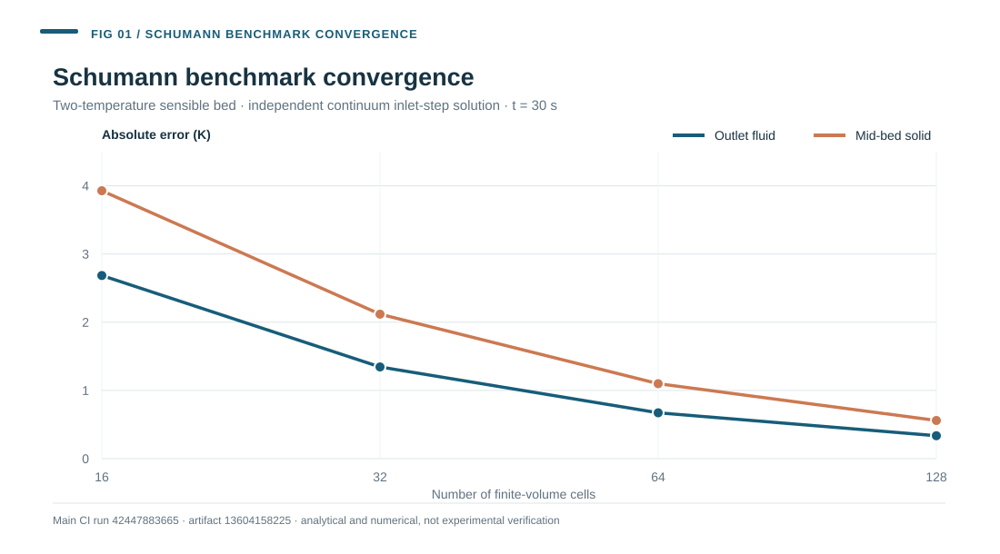
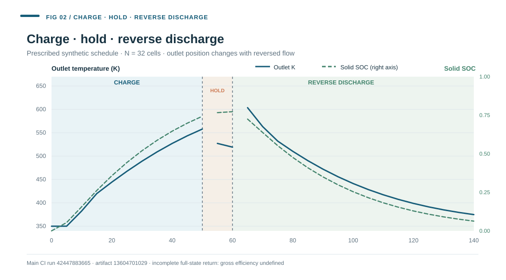
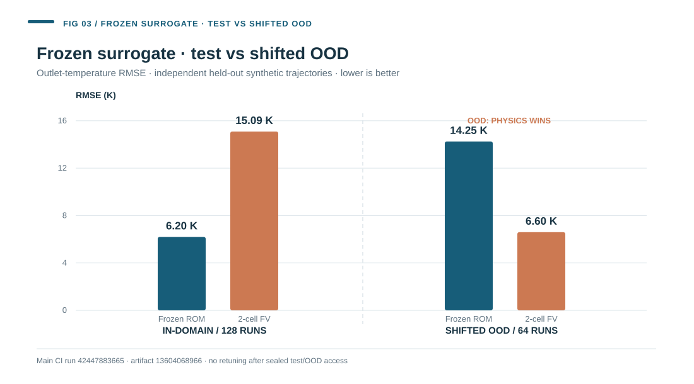
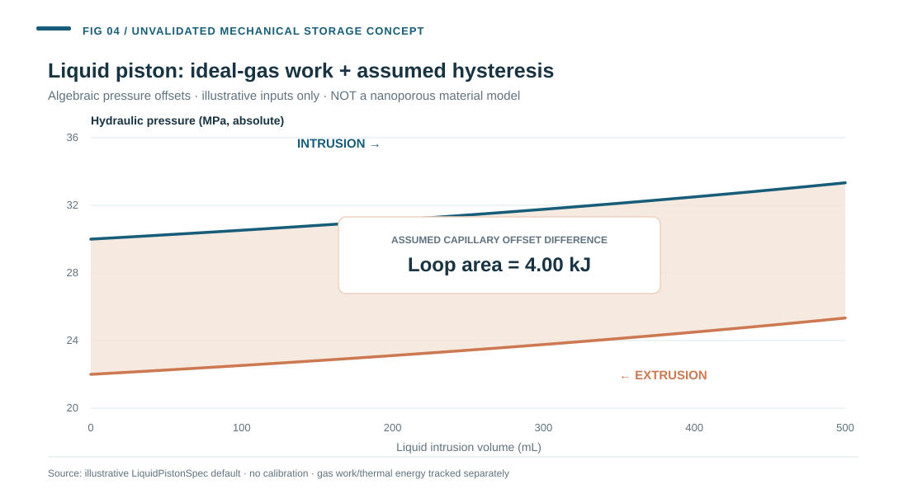

# Application research portfolio — thermal and mechanical energy storage

**Research software:** sCO₂-BraytonBench, Open Energy Methods, **parent development alpha 0.7.0a0** (not a tagged release).  
**Use:** concise technical evidence for prospective PhD research in thermal energy storage, physics-based numerical modelling, verification, surrogate/ROM methods and eventual experiment-led validation.  
**Current evidence boundary:** independent research carried out in software; **no experimental packed-bed or molecular-spring dataset has been collected, fitted or validated in this repository**. This is not a CIC energiGUNE/COMPETENT deliverable or an institutional endorsement.

[Repository homepage](../../README.md) · [TES complete research baseline](../tes/13_RESEARCH_BASELINE_TECHNICAL_REPORT.md) · [Prospective experimental protocol](PROSPECTIVE_EXPERIMENTAL_VALIDATION_PROTOCOL.md) · [Liquid-piston model concept](LIQUID_PISTON_CONCEPT.md) · [Evidence provenance](EVIDENCE_AND_FIGURE_SOURCES.md)

## 1. Research question and engineering scope

Can a first-principles, conservative **1-D two-temperature sensible packed-bed TES model** represent fluid/solid transient energy exchange with numerically controlled errors, and can a frozen reduced-order input/output emulator predict its synthetic outputs without concealing transfer failure? How would a separately bounded **gas–liquid piston with intrusion/extrusion hysteresis** extend an energy-ledger mindset toward mechanical storage without inventing material calibration?

The thermodynamic sCO₂ Brayton power-cycle component is a distinct parent software domain; TES is a separately modelled synthetic thermal subsystem with only an **open single-pass** CO₂ energy interface, not a dynamic full-cycle plant.

## 2. Verification figure: Schumann analytic versus finite volume

The uniform-initial-condition inlet-step Schumann continuum reference is independent of the finite-volume discretisation. At t=30 s, fluid-outlet errors decline **2.6845 → 0.3358 K** and midpoint-solid errors **3.9273 → 0.5595 K** from 16→128 cells. The finite-volume solver is first-order upwind in space and uses stability-controlled SSPRK3 in time with a boundary heat integral matched to the state integration. The first-law residual is a **numerical identity**, not a TES material-validation result. The front discontinuity is excluded from claims of uniform pointwise convergence.

**Reproduce:** ../../scripts/tes_schumann_convergence.py and ../../tests/test_thermal_storage.py. Chart numerical source: evidence/schumann_grid_20261108.csv, with original GitHub Actions artifact and SHA256 documented in EVIDENCE_AND_FIGURE_SOURCES.md.

## 3. Dynamic charge, hold and reverse-discharge time history

A separate synthetic N=32 full-fluid-and-solid-state schedule advances ten charging segments (0–50 s), two zero-flow hold intervals (50–60 s), and 16 reverse-discharge intervals (60–140 s). The plotted outlet is the physically upstream-to-downstream discharge measurement: **the observed outlet moves to the opposite physical bed end when mass-flow reverses**. Solid SOC remains explicitly tracked rather than assumed returned. The final solid SOC is ≈0.0633, the full cell temperature state **has not returned** (max return deviation ~48 K), and the gross cycle efficiency is consequently **undefined**, not a manufactured positive result.

This 140 s N=32 sequence is a dedicated **visual teaching run**, distinct from the more refined N=96 operating-window study below; do not conflate their geometry, heat totals or thermal-turnover schedules. Chart source: evidence/tes_stage_trace_20261108.csv, original CI artifact documented in EVIDENCE_AND_FIGURE_SOURCES.md.

## 4. Frozen reduced-order modelling: in-domain success, OOD failure

A deterministic 512-trajectory synthetic dataset was partitioned **256 train, 64 validation, 128 frozen in-domain test, 64 shifted OOD**, at the *complete-run* level. Validation alone selected the two HistGradientBoostingRegressor targets, outlet temperature and solid SOC; after freezing, neither held-out set was used for refitting.

| Partition | Frozen ROM outlet RMSE | Two-cell physics outlet RMSE | ROM SOC RMSE | Two-cell SOC RMSE |
|---|---:|---:|---:|---:|
| 128-run in-domain test | **6.1965 K** | 15.0918 K | **0.011619** | 0.036980 |
| 64-run shifted OOD | 14.2522 K | **6.5965 K** | 0.028423 | **0.014768** |

**The negative OOD result is central:** the simple physically conservative comparator wins when flow and inlet temperature move beyond the training envelope. The ROM is not a full spatial state, an energy-closed transient, a causal online controller or an experimental prediction. Six predeclared in-domain gates passed; no OOD accuracy gate passed by analogy. Original training/holdout artifacts are recorded in the evidence ledger and ../tes/09_FROZEN_ROM_RESULTS_2026-11-07.md.

## 5. Storage operating window and numerical uncertainty

The separate **N=96 synthetic operating-window study** evaluates 29 one-at-a-time inputs and eight fully crossed flow/porosity/Hv corners with grid/time sensitivity, exergy and independently counted temperature-qualified service.

- Recovered thermal energy: **2.120487 MJ**, but **only 6.570557 kJ** delivered at/above the illustrative 500 K outlet-grade criterion (~0.31% of recovered heat).
- Refinement N=96→192 changed total recovered heat by ~0.253% and temperature-qualified heat by ~3.42%, demonstrating why low first-law residual is not sufficient to assert grade resolution.
- A 500→550 K service threshold can remove all nominal temperature-qualified heat **without changing first-law recovered heat**.
- The final physical cell state does not return, so a gross energy round-trip efficiency is **not defined**. No pressure-loss work, heat leakage, installed equipment efficiency or field uncertainty is included.

[Methods](../tes/10_OPERATING_WINDOW_SENSITIVITY.md) · [Executed quantitative results](../tes/11_OPERATING_WINDOW_RESULTS_2026-11-07.md) · [Script](../../scripts/tes_operating_window_study.py).

## 6. Proposed experiment-led extension — no measurements claimed

The [candidate verification and validation protocol](PROSPECTIVE_EXPERIMENTAL_VALIDATION_PROTOCOL.md) specifies suggested inlet/outlet and 10 axial temperature channels, upstream/downstream pressure taps, signed mass flow, wall/ambient thermal losses, calibration metadata, synchronized timebase, uncertainty propagation, pre-registered training versus held-out complete runs and identifiability checks.

Real facility geometry, P&IDs, sensor installation, material properties, permits and qualified operators are **not available**, so all run IDs and channel selections remain **PROPOSED/NOT EXECUTED**. The project defines an experiment *plan*, not a successful comparison against real data.

## 7. Prospective liquid-piston / molecular-spring mathematical concept

The [bounded gas–liquid work demonstrator](LIQUID_PISTON_CONCEPT.md) separates an ideal-gas isothermal or reversible-adiabatic compression/expansion term from **externally specified** intrusion/extrusion pressure offsets. It reports P–V loops and a nonnegative hysteresis loss with independently tested first-law conservation. This is **not** an identified pore-pressure relation, a nanoporous fluid model, a calibrated gas compressor, CFD or a claim about any COMPETENT prototype.

Run from root: python examples/liquid_piston_concept.py --out evidence/generated/liquid_piston_concept.

## 8. What this portfolio establishes—and what it cannot

**Demonstrated in this software:** independently re-derived numerical equations, thermodynamic and dimensional checks, open scientific evidence, algorithm implementation, deterministic synthetic data split, conservative energy accounting, numerical refinement, quantitative operating-window sensitivity and honest negative transfer reporting.

**Not demonstrated:** a multidimensional CFD TES solution, latent-heat PCM model, real nanopore intrusion/extrusion physics, measured TES/pressure-volume calibration, laboratory instrumentation commissioning, external scientific sign-off, a validated physical control system or a full transient CO₂ plant. Relevant separate background CFD experience should be documented in the candidate's CV, not imputed to this code.

**Research ethics and governance:** preserved failures and nonresults are part of the evidence; Mantilla historical source-rights issue #27 and independent human review issue #28 remain open; no parent v1.0 release, DOI or unauthorized third-party experimental data is asserted.

## 9. Reproduction and reviewer navigation

- Build source and run all tests: python -m pip install -e '.[test,co2,ml]' 'CoolProp==8.0.0', then python -m pytest -q.
- Regenerate the Schumann benchmark: python scripts/tes_schumann_convergence.py --out evidence/generated/tes_v03.
- Regenerate the 28-stage schedule: python examples/tes_charge_discharge.py.
- Re-run 0.8 operating-window from scratch: python scripts/tes_operating_window_study.py --out evidence/generated/tes_v08.
- Freeze/inspect ROM without leakage: [full training and holdout method](../tes/08_FROZEN_SPLIT_SURROGATE.md), [frozen evidence](../tes/09_FROZEN_ROM_RESULTS_2026-11-07.md).
- Inspect exact CI evidence source, archive IDs, CSV column units, rounding and synthetic/nonphysical boundaries: [evidence provenance](EVIDENCE_AND_FIGURE_SOURCES.md).

This page is the appropriate starting point for a doctoral application reviewer; see the separate parent README for other sCO₂ research directions.
